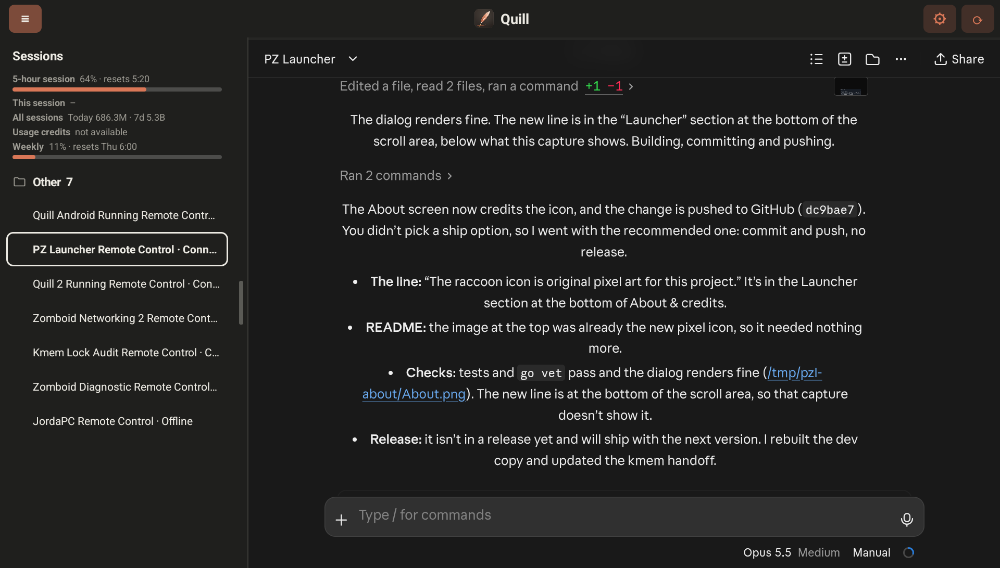

# Quill for Android

An Android companion to [Quill](https://github.com/katachinosekai/quill), the desktop app for Claude Code sessions. Unofficial; not affiliated with Anthropic.

Quill for Android lets you control the Claude Code sessions running in Quill on your computer from your phone. It uses Claude Code's own Remote Control: no server of its own, no API key, no extra login. Quill turns Remote Control on for its sessions. This app opens claude.ai/code, where those sessions appear, and gives it Quill's look and organisation.

<p></p>

*Quill Android on a tablet, paired with Quill Desktop: the session list with usage on the left, the open session on the right.*

## Features
- Usage at a glance like Quill's strip: 5-hour and weekly limits, this session's tokens and context, today's total (needs Quill 0.1.8+ on the same network).
- Folder lists show each session's age, message count and a status dot, like Quill.
- Tab bar of open sessions and a folder bar with drop-down session lists, as in Quill. On tablets and unfolded foldables, a vertical folder sidebar instead (Tabs: Auto / Horizontal / Vertical in ⚙)
- Sessions grouped by Quill's folders: Active, your own folders, Inactive, Archive, Created by Claude. Quill publishes its folders and the app picks them up (see "Folders from Quill").
- Quill's dark theme and accent, readable text: comfortable line spacing, wrapped code blocks, scrollable tables, no zoom jumps when typing.
- Centering like Quill: Center everything, or Chat text / Typing / Status separately.
- Text size: pinch with two fingers; text reflows to the screen, so formatting and layout stay intact. Reset in ⚙.
- Long-press a folder: Open all in tabs (and expand/collapse all in the sidebar).
- Arrows to slide side panels away, as in Quill.
- Email sign-in links open straight in the app.
- Home screen (paired with Quill Desktop): long-press the app icon for New session and your recent sessions; long-press a session → Add to home screen; a Quill widget lists the sessions waiting for you first, then running and recent ones.
- Share to Quill: share text or a link from any app, pick a session (or a new one), and it lands in the message box to edit and send.

## Install
Quill (desktop) and Quill for Android are released together on [Quill's releases](https://github.com/katachinosekai/quill/releases); this repo's [releases](https://github.com/katachinosekai/quill-android/releases) carry the APK too and feed the in-app updater.

1. Download `quill-android-<version>.apk` from [Releases](https://github.com/katachinosekai/quill-android/releases).
2. Open it on your phone and allow installs from that source. Android 11 or newer.
3. Sign in to claude.ai with **email** (your Gmail address works). Google and Apple block their sign-in inside apps; the app explains this if you tap those buttons. If the email has a link, allow Quill to open claude.ai links (⚙ → Open claude.ai links in Quill) or use ⚙ → Paste sign-in link.

**Samsung phones/tablets:** Auto Blocker (Settings → Security and privacy → Auto Blocker) blocks installing and updating apps that don't come from Google Play or the Galaxy Store. Turn it off while you install or update Quill, then turn it back on. If Google Play Protect warns about the app, tap "More details" → "Install anyway". From 0.9.1 the app explains this when an update is blocked and lets you retry with one tap.

From 0.7.0 on, the app updates itself from GitHub releases: it shows a banner when a new version is out, checks the download's checksum and that it's signed with the same key, then Android asks you to confirm.

On your computer, run Quill (0.1.0 or newer) with "Remote Control for every session" on (the default).

## Folders from Quill
In Quill (0.1.1 or newer), open Settings → Phone:
1. **Pair phone...** shows a QR code. In Quill for Android, tap ⚙ → "Scan pairing QR code" and point the camera at it (or copy the link and use ⚙ → "Paste pairing link"). Some phone camera apps can't open the pairing link themselves, so scan from inside the app. Folders then update whenever your phone is on the same network as your computer. Away from home, the app keeps the last folders it got.
2. Optional, to get updates anywhere:
   - **Write folders file to...**: pick a folder you already sync to your phone (Syncthing, Nextcloud, Dropbox, ...), then in the app ⚙ → "Choose synced file" and pick `quill-folders.json`.
   - **Publish to a secret gist** (needs the GitHub CLI `gh` logged in on the computer): pair again afterwards so the link includes the gist. The gist is unlisted but readable by anyone with its link. It contains only claude.ai session ids and folder names.

The app uses whichever source has the newest folders.

## Notifications
With Quill 0.1.5 or newer (paired as above), the app notifies you when a session needs approval, asks a question, has a plan to approve, finishes or hits an error, but not for the session you're looking at. Tap a notification to open that session. Approval notifications show the command and have Allow and Deny buttons, so you can answer without opening the app (if Quill Desktop wants this device's password, open the app once to unlock). Choose the types in ⚙ → Notifications.

While the app is closed, turn on ⚙ → "Notify in background (local network)": Android then shows a small "Quill is watching for approvals" notification with a Stop button. Background alerts work on the same network as your computer (or over Tailscale/VPN). Notifications only carry session titles and folders, never chat content.

## How it works
The app is a WebView of `https://claude.ai/code` with a small script (`app/src/main/assets/quill.js`) injected on every page. The script restyles the page and builds the session drawer from the session links on the page. It never sends data anywhere; everything stays between your phone and claude.ai. Design notes are in [COMMENTS.md](COMMENTS.md).

## Build
Requires JDK 21 and the Android SDK (platform 36). Point `local.properties` at your SDK (`sdk.dir=...`), then:

```
./gradlew assembleRelease
```

Emulator tests: `scripts/emu-test.sh --avd qfold` (also `qphone`, `qtab`). It needs the Android emulator and the android-36 x86_64 system image, and for the pairing checks the Quill source next to this repo and Go.

For a signed release, create `~/Android/quill-release.properties` with `storeFile`, `storePassword`, `keyAlias` and `keyPassword`. Without it the release build is unsigned (`./gradlew assembleDebug` also works).

## License
GPL-3.0-or-later. See [LICENSE](LICENSE) and [NOTICE](NOTICE). Releases up to and including 0.9.6 were published under the MIT License. QR codes are decoded with [ZXing](https://github.com/zxing/zxing) core (Apache-2.0).
