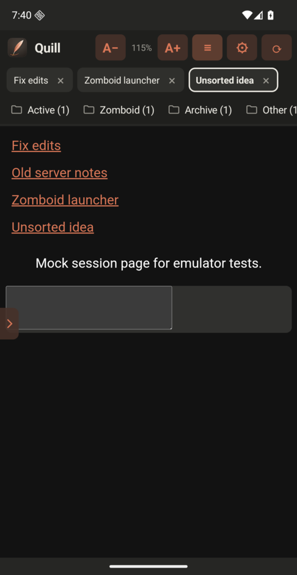
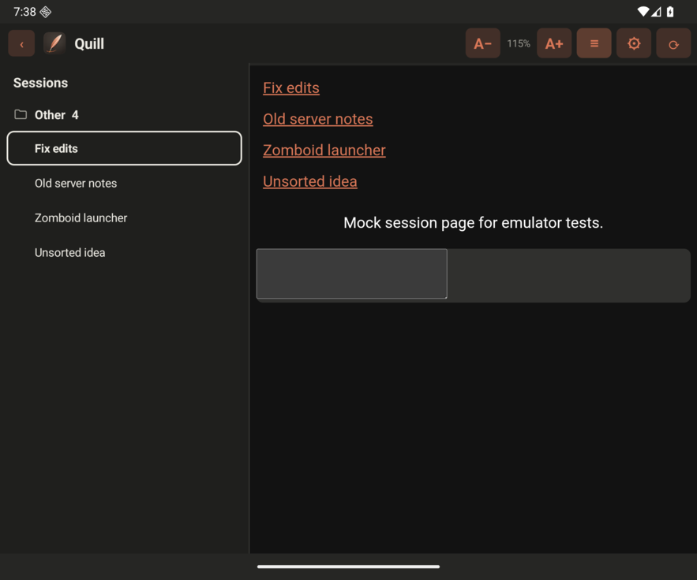

# Quill for Android

An Android companion to [Quill](https://github.com/katachinosekai/quill), the desktop app for Claude Code sessions. Unofficial; not affiliated with Anthropic.

Quill for Android lets you control the Claude Code sessions running in Quill on your computer from your phone. It uses Claude Code's own Remote Control: no server of its own, no API key, no extra login. Quill turns Remote Control on for its sessions. This app opens claude.ai/code, where those sessions appear, and gives it Quill's look and organisation.

<p>


</p>

*Phone with the tab bar and Quill's folders (left), unfolded foldable with the vertical sidebar (right). Screenshots from the emulator test page.*

## Features
- Tab bar of open sessions and a folder bar with drop-down session lists, as in Quill. On tablets and unfolded foldables, a vertical folder sidebar instead (Tabs: Auto / Horizontal / Vertical in ⚙)
- Sessions grouped by Quill's folders: Active, your own folders, Inactive, Archive, Created by Claude. Quill publishes its folders and the app picks them up (see "Folders from Quill").
- Quill's dark theme and accent, readable text: comfortable line spacing, wrapped code blocks, scrollable tables, no zoom jumps when typing.
- Centering like Quill: Center everything, or Chat text / Typing / Status separately.
- Text size: pinch with two fingers; text reflows to the screen, so formatting and layout stay intact. Reset in ⚙.
- Long-press a folder: Open all in tabs (and expand/collapse all in the sidebar).
- Arrows to slide side panels away, as in Quill.
- Email sign-in links open straight in the app.

## Install
Quill (desktop) and Quill for Android are released together on [Quill's releases](https://github.com/katachinosekai/quill/releases); this repo's [releases](https://github.com/katachinosekai/quill-android/releases) carry the APK too and feed the in-app updater.

1. Download `quill-android-<version>.apk` from [Releases](https://github.com/katachinosekai/quill-android/releases).
2. Open it on your phone and allow installs from that source. Android 11 or newer.
3. Sign in to claude.ai with **email** (your Gmail address works). Google and Apple block their sign-in inside apps; the app explains this if you tap those buttons. If the email has a link, allow Quill to open claude.ai links (⚙ → Open claude.ai links in Quill) or use ⚙ → Paste sign-in link.

From 0.7.0 on, the app updates itself from GitHub releases: it shows a banner when a new version is out, checks the download's checksum and that it's signed with the same key, then Android asks you to confirm.

On your computer, run Quill (0.1.0 or newer) with "Remote Control for every session" on (the default).

## Folders from Quill
In Quill (0.1.1 or newer), open Settings → Phone:
1. **Pair phone...** shows a QR code. Scan it with your phone's camera and open the link in Quill for Android (or copy the link and use ⚙ → "Paste pairing link"). Folders then update whenever your phone is on the same network as your computer. Away from home, the app keeps the last folders it got.
2. Optional, to get updates anywhere:
   - **Write folders file to...**: pick a folder you already sync to your phone (Syncthing, Nextcloud, Dropbox, ...), then in the app ⚙ → "Choose synced file" and pick `quill-folders.json`.
   - **Publish to a secret gist** (needs the GitHub CLI `gh` logged in on the computer): pair again afterwards so the link includes the gist. The gist is unlisted but readable by anyone with its link. It contains only claude.ai session ids and folder names.

The app uses whichever source has the newest folders.

## How it works
The app is a WebView of `https://claude.ai/code` with a small script (`app/src/main/assets/quill.js`) injected on every page. The script restyles the page and builds the session drawer from the session links on the page. It never sends data anywhere; everything stays between your phone and claude.ai. Design notes are in [COMMENTS.md](COMMENTS.md).

## Build
Requires JDK 21 and the Android SDK (platform 36). Point `local.properties` at your SDK (`sdk.dir=...`), then:

```
./gradlew assembleRelease
```

Emulator tests: `scripts/emu-test.sh --avd qfold` (also `qphone`, `qtab`). It needs the Android emulator and the android-36 x86_64 system image, and for the pairing checks the Quill source next to this repo and Go.

For a signed release, create `~/Android/quill-release.properties` with `storeFile`, `storePassword`, `keyAlias` and `keyPassword`. Without it the release build is unsigned (`./gradlew assembleDebug` also works).

## License
MIT. See [LICENSE](LICENSE).
